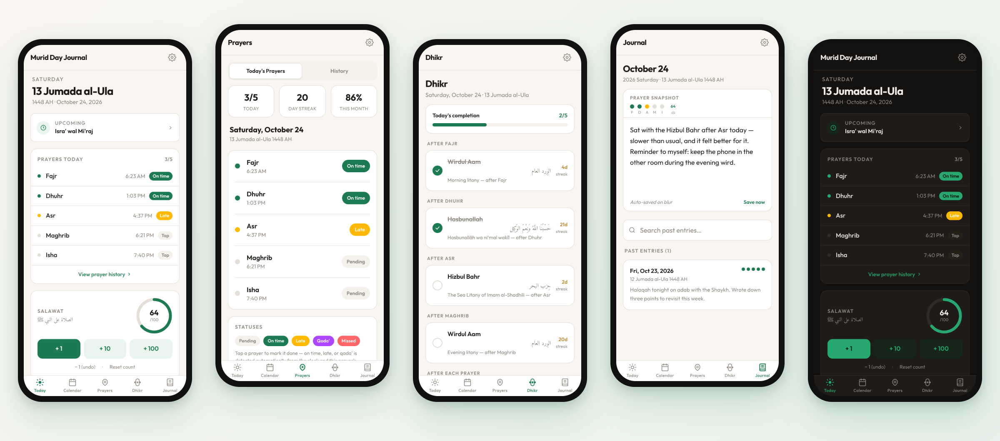
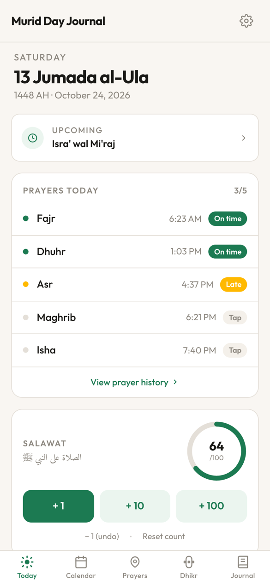
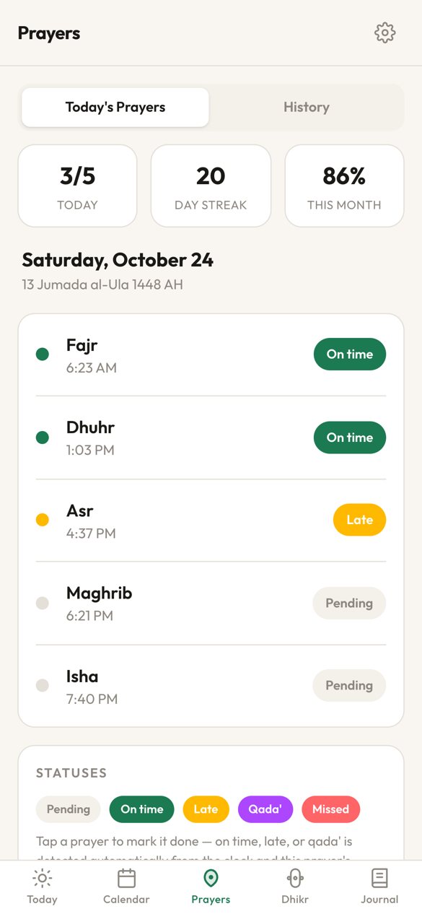
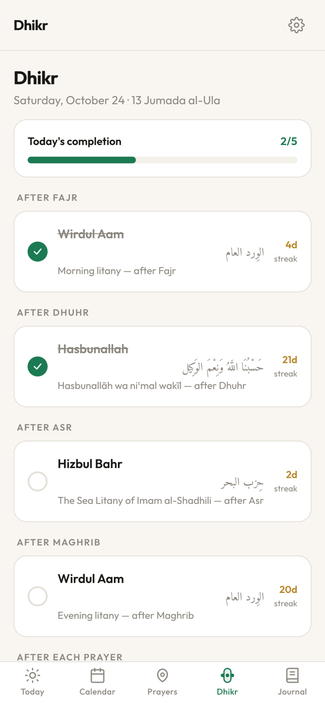
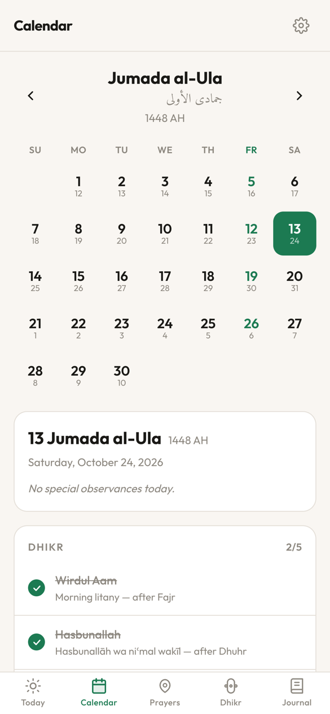
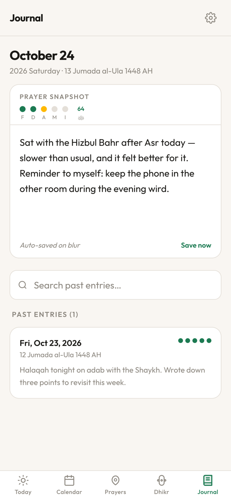
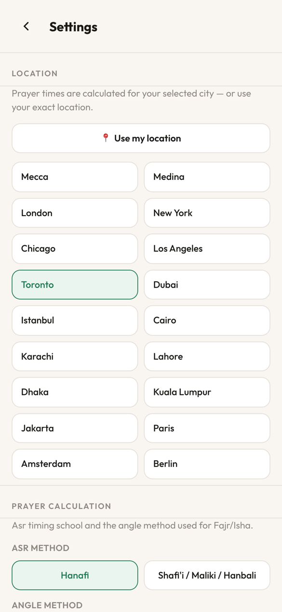

# The Seekers Journal

A personal Islamic calendar and worship tracker for the murid's day: the five
prayers, the daily awrad, salawat, the Hijri calendar and a short daily journal,
in one installable PWA. Self-hosted on `mavis`.



> Screenshots use made-up demo data, not real journal entries.

## Features

- **Today**: Hijri and Gregorian date, the next Islamic observance, today's
  prayers with their times, and a salawat counter with a daily goal.
- **Prayers**: tap a prayer to mark it. On-time, late and qada' are detected
  from the clock and each prayer's actual window (Fajr closes at sunrise, not
  Dhuhr). Missed is an explicit choice. Shows the streak, the monthly rate and
  the history.
- **Dhikr**: the daily awrad tied to prayer times (Wirdul Aam after Fajr and
  Maghrib, Hasbunallah after Dhuhr, Hizbul Bahr after Asr, Salatut Ta'ziyah
  after each prayer), each with its own streak.
- **Calendar**: a Hijri month view with Gregorian dates, Islamic events and
  their action items, plus community and halaqah notes.
- **Journal**: one entry per day with a snapshot of that day's prayers and
  salawat. Past entries are searchable.
- **Push notifications** (Web Push, works on iOS 16.4+ when installed to the
  home screen):
  - prayer reminders, sent a configurable number of minutes before each prayer
  - dhikr reminders
  - Islamic event reminders
  - a daily hadith on the virtue of salah
  - an evening nudge for prayers you haven't marked yet

  Non-prayer notifications are spaced at least 3 hours apart so they never pile
  up on the lock screen. Prayer reminders are never delayed.
- **Settings**: city preset or device location, Asr method (Hanafi or
  Shafi'i), Fajr/Isha angle method (MWL, ISNA, Karachi, Egyptian), and light,
  dark or system theme.

| Today | Prayers | Dhikr |
| :---: | :---: | :---: |
|  |  |  |
| **Calendar** | **Journal** | **Settings** |
|  |  |  |

## How it works

```
React + Vite PWA  ──(localStorage, instant)──▶  UI
       │
       └── debounced PUT /api/state ──▶  Express server  ──▶  data/state.json
                                              │
                                    node-cron tick (60s) ──▶  web-push ──▶ phone
```

- **Local-first.** Every change is written to `localStorage` right away. The
  whole state is then mirrored to the server in the background. If the server
  can't be reached, the next change retries the sync.
- **Single user.** The server keeps the state as one JSON blob. There are no
  accounts.
- **Server-side scheduling.** The server computes prayer times itself
  (`server/prayerTimes.js`, `server/hijri.js`) and sends reminders even when
  the app is closed.

| Path | What it is |
| --- | --- |
| `src/screens/` | One component per tab, plus onboarding and settings |
| `src/store/index.ts` | App state, prayer-status logic, server sync |
| `src/utils/` | Hijri conversion and prayer-time calculation |
| `server/index.js` | Express: state API, push endpoints, static `dist/` |
| `server/scheduler.js` | Reminder scheduling and the anti-stacking queue |
| `public/sw.js` | Service worker (offline support and push display) |

## Running it

### Production (mavis)

The app runs with Docker Compose from `~/services/murid-day-journal` and
listens on port **3011**.

```bash
cd ~/services/murid-day-journal
git pull
docker compose up -d --build
```

Runtime data lives in `./data/`, which is mounted into the container and
**not tracked in git**:

| File | Contents |
| --- | --- |
| `state.json` | All prayers, dhikr, salawat, journal entries and settings |
| `vapid.json` | Web Push key pair, generated on first start. **Keep it.** If it is lost, every device must subscribe again. |
| `push-subscriptions.json` | Registered devices |
| `sent-log.json`, `notif-queue-state.json` | Scheduler bookkeeping |

Back up `data/` if you care about the journal.

Set `VAPID_SUBJECT` (for example `mailto:you@example.com`) in the environment
or in a `.env` file next to `docker-compose.yml`.

### Local development

Requires Node 22 and pnpm (see `.mise.toml`).

```bash
pnpm install
pnpm build && pnpm start      # full app with the API on http://localhost:3011
pnpm dev                      # Vite dev server, UI only (no /api proxy)
```

Run with `DATA_DIR=/some/tmp/dir` to keep local testing away from real data.

## Origin

Scaffolded in Figma Make (see `AGENTS.md` and `.figma/`), then extended with
the Express backend, push notifications and Docker deployment.
